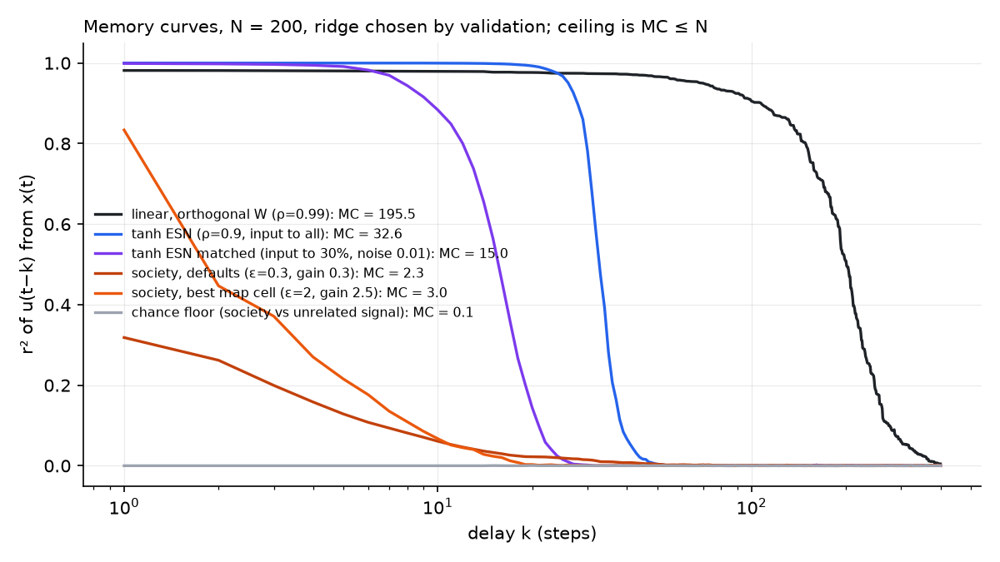
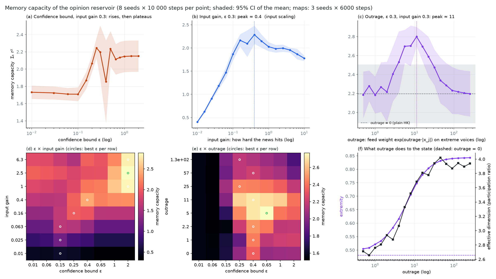
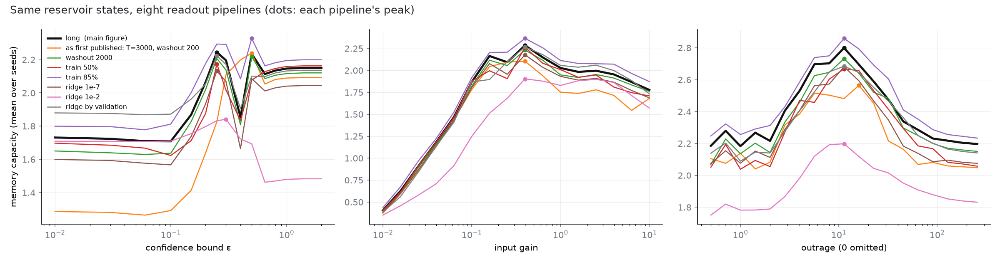
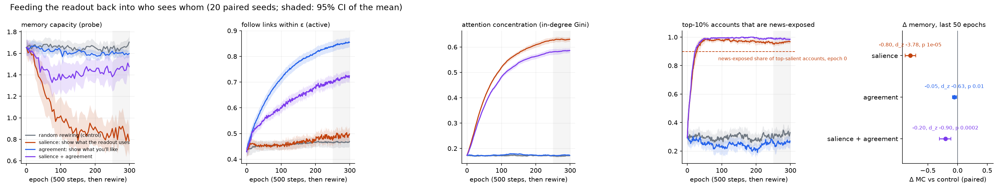
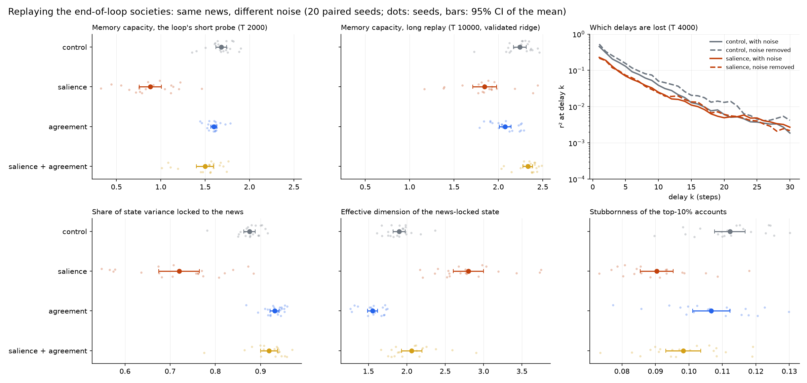
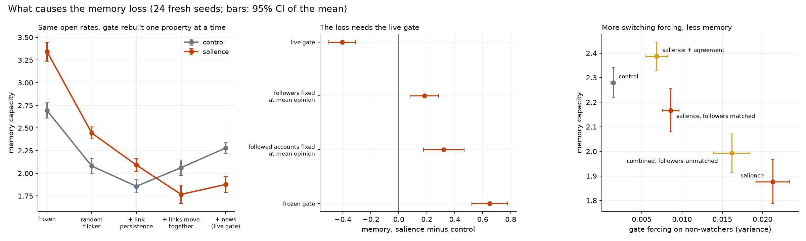
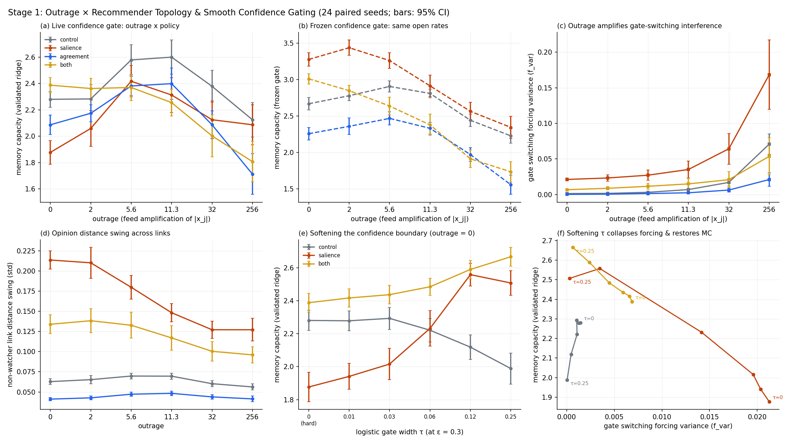

# Bound-Opinion-Reservoir

A bounded-confidence opinion model used as a reservoir computer.

A population of agents runs Hegselmann–Krause dynamics on a follow graph while a
subset of them is driven by an external signal (the news). A linear ridge readout
is trained on the agents' opinions to recover the signal's recent past. The
questions: how much can a society *remember*, as a function of how open-minded it
is, how loud the news is, and how much the feed amplifies extreme voices? And what
happens when a recommender uses that readout to decide who sees whom?

## Summary

- **The confidence bound gives no inverted U at the default settings.** Memory rises
  from closed-minded societies to a plateau and stays there. An inverted U in ε
  appears only when the news is quiet, and the best ε moves up as the news gets louder.
- **Input gain gives a clean inverted U, but it is the textbook input-scaling optimum
  of reservoir computing**, not a finding about outrage.
- **Outrage, modelled as the feed amplifying extreme voices, gives an inverted U of its
  own** at fixed input: memory capacity 2.36 → 2.81 → 2.28 (plain HK → outrage ≈ 11 →
  outrage 256) on 24 fresh seeds. This is the candidate central figure.
- **The society is a poor memory.** Through the same pipeline, an echo state network
  matched to it remembers about 15 steps of news; the society remembers 2–3.
- **Feeding the readout back into who sees whom costs some memory.** A recommender that
  shows people the accounts its readout relies on turns news-exposed agents into hubs
  (largely expected, see below) and cuts memory capacity from 2.24 to 1.85 on long
  replays with validated ridge. The loop's short probes showed 1.65 → 0.86, which
  overstated the loss. On 24 fresh seeds the loss is concentrated in the non-watchers.
- **The confidence bound causes that loss, not the hubs.** With a gate that ignores
  opinions, the salience network remembers *more* than random rewiring (3.34 vs 2.69 with
  a frozen gate). Under the live bound, links to hubs keep crossing ε, and the switching
  interferes with what the readout can decode. All eleven tests fixed in advance pass on
  24 unused seeds.
- **It is the hard threshold cliff at ε, not distance-dependent confidence itself, and
  outrage interacts with hub topologies.** Replacing the step gate `1(|x_i − x_j| < ε)`
  with a smooth logistic boundary of width τ = 0.12 keeps bounded confidence live and
  opinion-dependent, cuts gate-switching forcing on salience by 6× (0.021 → 0.0035), and
  flips salience from −0.40 behind control to +0.44 ahead (2.56 vs 2.12; +0.38 when
  calibrated to match active-link rates). Moderate outrage (11.3) boosts control (+0.32)
  and salience (+0.44, by evacuating undecided links from 57% to 23%), but fails to help
  the combined salience + agreement policy (difference-in-differences +0.45) and erodes
  the frozen-gate hub lead (+0.61 → +0.10) because high-gain hubs saturate under feed
  amplification. All nine pre-registered tests pass on seeds 300–323 (Holm p ≤ 0.00025).

## The model ([bor/model.py](bor/model.py))

200 agents with opinions in [-1, 1], each following 10 random others. Per step:

1. **HK update on the graph, with outrage.** Each agent looks at the accounts it follows
   (plus itself) whose opinions lie within the confidence bound **ε**, and moves halfway
   toward their weighted mean. Account j's weight is exp(**outrage** · |x_j|). At
   outrage = 0 this is plain HK; as outrage grows, the most extreme visible voices
   dominate the feed. Extremity stands in for outrage-inducing content. The mechanism
   never touches the news input.
2. **Stubbornness.** Each agent is pulled back toward its own prior opinion at a personal
   rate in [0.02, 0.2] (Friedkin–Johnsen anchoring). Without it, informed agents
   integrate the news without leak and pin to ±1.
3. **News.** 30% of agents are informed and receive `input_gain · w_i · u(t)`, where `u` is
   i.i.d. uniform in [-1, 1] and `w_i ∈ [-1, 1]` is how each reads the news. **Input
   gain** is how hard the news hits: plain input scaling.
4. Small noise, then the opinion is clipped to [-1, 1].

## The readout ([bor/readout.py](bor/readout.py))

Closed-form ridge regression on the opinion vector plus a bias, trained on the first 70%
of the run after washout and scored on the last 30%:

- **Memory capacity** (Jaeger): Σₖ r²(u(t−k), readoutₖ(x(t))) for k = 1…30.
- **NARMA-10** one-step NRMSE, as a nonlinear check.

Main results use 10 000-step runs, washout 500 and ridge α = 1e-4 per sample. Other
pipelines are checked below.

## How much can a society remember? ([scripts/sanity_mc.py](scripts/sanity_mc.py))



Same pipeline, N = 200, delays out to 400, T = 20 000:

| reservoir | MC (validated ridge) | effective dimension |
|---|---|---|
| linear, orthogonal W, ρ = 0.99 | 195.5 | 63 |
| tanh ESN, ρ = 0.9, input to all | 32.6 | 6 |
| tanh ESN matched to the society (input to 30%, same noise) | 15.0 | 6 |
| society, defaults (ε 0.3, input gain 0.3) | 2.3 | 2.2 |
| society, best map cell (ε 2, input gain 2.5) | 3.0 | 1.1 |
| chance floor: society vs an unrelated signal | 0.06 | — |

- The pipeline reaches the theoretical ceiling MC ≤ N on a linear reservoir (195.5 of 200)
  and gives ~0 on an unrelated signal.
- The society's memory sits in the first 10–20 delays, so scoring 30 delays truncates
  nothing.
- Why so little: every informed agent stores each headline along the same direction (its
  susceptibility w_i) and forgets at nearly the same rate. The readout can tell yesterday
  from today only through the spread in stubbornness and neighbourhoods. The state is
  effectively 1–4 dimensional (participation ratio).
- The default ridge (1e-4) under-reads the tanh ESN by ~30% (23.7 vs 33). For the society
  it is within ~12% of validated ridge and doesn't change any curve's shape (below).

## Result 1: the sweeps ([scripts/sweep.py](scripts/sweep.py))



8 seeds × 10 000 steps per point; bands are 95% CIs of the mean; maps are 3 seeds × 6000
steps. Because the peaks were read off these seeds, the key contrasts were re-tested on
24 fresh seeds (100–123), paired by seed and Holm-corrected
([scripts/confirm.py](scripts/confirm.py), [results/confirm.txt](results/confirm.txt)).

**(a) Confidence bound.** MC is 1.7 for ε ≤ 0.1, where closed-minded agents never pass the
news on and the 70% who don't watch it are dead weight. It plateaus around 2.15–2.25 from
ε ≈ 0.25. On fresh seeds, ε 2 beats ε 0.01 by +0.41 [+0.30, +0.52], but ε 0.25 vs ε 2 is
+0.07 [−0.08, +0.21], p = 0.4: **no inverted U at this gain.** The wide bands near
ε ≈ 0.3–0.5 are the fragmentation–consensus transition. At ε = 0.5 half the seeds have
collapsed toward consensus and half stay split. At ε = 0.4 a few seeds' readouts fit
their training block as well as any other seed but score half as well on test; extremity
stays flat through those runs, and the cause isn't pinned down.

**(b) Input gain.** Inverted U: 0.40 → 2.28 (gain 0.4) → 1.78 (gain 10). On fresh seeds,
gain 0.4 beats 0.04 by +1.05 and 10 by +0.56 (23–24 of 24 seeds each). This is the
standard input-scaling optimum: too quiet and the news drowns in noise and stubbornness,
too loud and informed agents saturate and overshoot everyone's confidence bound.

**(c) Outrage.** Inverted U at fixed input: plain HK 2.20 → 2.80 at outrage ≈ 11 → 2.20
from outrage ≈ 100 on. On fresh seeds, outrage 11.3 beats 0 by +0.46 [+0.35, +0.56]
(21/24 seeds) and 256 by +0.53 [+0.43, +0.67] (24/24), p < 10⁻⁵ after Holm. Validated
ridge gives +0.44 and +0.59.

**(d) ε × input gain.** The best ε rises with the gain: 0.15 for quiet news, 0.25 at 0.16,
0.4 at 0.4, and 2 (full mixing) at gain ≥ 1. The bound must be wider than a news kick or
the agents who heard the news drift out of everyone else's range. An inverted U in ε only
exists for quiet news: at gain 0.063, 1.63 at ε 0.15 vs 1.08 at ε ≥ 0.65.

**(e) ε × outrage.** Outrage does nothing when ε ≤ 0.06: nobody is in reach, so there is
nothing to amplify. For every ε ≥ 0.25, memory peaks at moderate outrage (5–11) and falls
beyond it. Best cell: outrage 5, ε 0.65 (2.77).

**(f) Why.** Moderate amplification pulls opinions apart (mean |x| 0.48 → 0.75 at outrage 11)
and raises the effective dimension (2.6 → 3.7), so more distinct opinion positions carry
more independent traces of the news. Past outrage ≈ 11, extremity and dimension level off
but memory falls. A reading, not a measurement: the update approaches "copy the most
extreme account you can see", a winner-take-all rule that keeps who is loudest and
discards graded information about the news.

NARMA-10 ([figures/narma.png](figures/narma.png)) moves the same way, weakly: best NRMSE
0.65–0.66 at input gain 0.4–1 and outrage 5–11, against 0.68 at outrage 0.

### Readout robustness



The same states scored under eight readout pipelines (run length, washout, train/test
split, ridge 1e-7 / 1e-4 / 1e-2 / validated). Input gain peaks at 0.4 under all eight;
outrage peaks at 11.3 under seven (16 under the short run). The ε curve is the fragile
one. With the first draft's short runs (T = 3000) closed-minded societies scored 1.28,
with 10 000 steps 1.73, with validated ridge 1.88. Most of the first draft's "step" in ε
was the readout overfitting 140 agents that carry only noise. Strong ridge (1e-2)
instead bends the right side of the ε curve down: full-mixing states are nearly collinear,
and their signal sits in low-variance directions that heavy regularization suppresses.

## Result 2: closing the loop ([bor/recommender.py](bor/recommender.py), [scripts/feedback.py](scripts/feedback.py))

Every epoch (500 steps) the platform fits a readout for `u(t−1)` and scores each account
by its salience to that readout, `|W_j| · std(x_j)`. Then each agent, with probability
0.1, unfollows a random account and gets a recommendation drawn from
`softmax(β_s · salience_j + β_a · agreement_ij)`. Memory capacity is measured every 5
epochs on a frozen copy of the society with a fresh probe signal. Structural metrics are
averaged over each epoch. 20 seeds, each with its own news; seed s gives every policy the
same starting society, so policies are compared with the control seed by seed. 300
epochs: the salience policy's Gini plateaus around epoch 250. The summary window is the
last 50 epochs ([results/feedback_stats.txt](results/feedback_stats.txt)).



| policy (last 50 of 300 epochs) | memory capacity | Δ vs control [95% CI], d_z | active links | in-degree Gini | top-10% news-exposed | effective dimension | non-watchers' mean \|corr\| |
|---|---|---|---|---|---|---|---|
| random rewiring (control) | 1.65 | — | 0.47 | 0.17 | 0.32 | 2.2 | 0.20 |
| salience (β_s = 8) | 0.86 | −0.80 [−0.88, −0.70], −3.8 | 0.49 | 0.63 | 0.96 | 3.9 | 0.44 |
| agreement (β_a = 8) | 1.60 | −0.05 [−0.09, −0.02], −0.6 | 0.85 | 0.17 | 0.26 | 1.7 | 0.21 |
| salience + agreement | 1.45 | −0.20 [−0.31, −0.11], −0.9 | 0.71 | 0.58 | 0.99 | 2.3 | 0.66 |

Sign-flip p-values: salience 10⁻⁵, agreement 0.012, both 2·10⁻⁴. These memory numbers
come from the loop's short probes (T = 2000, so 1260 training steps for 200 weights) and
are biased low; the long replays below are the ones to quote.

**What is built in.** Before any rewiring, news-exposed agents are 30% of the society but
hold 60% of readout salience and 90% of the top-10% salient slots. A recommender that
promotes salient accounts makes them hubs almost by construction: the harvester elevates
whoever is closest to the signal. The dashed line in the fourth panel marks that
epoch-0 share; the salience policy overshoots it, ending with 96% of the top-10%
most-followed accounts news-exposed.

**What is not built in:**

- **The salience recommender costs memory**, though less than the short probes suggest
  (see the replay section below).
- **The memory loss is not the state collapsing.** The first draft's explanation was that
  everyone following the same hubs turns the 70% who don't watch the news into copies of
  each other. Measured on the same probes, that fails three ways:
  - Effective dimension *rises* under salience, 2.2 → 3.9 (+1.74 [+1.41, +2.06]), while
    memory falls. There are more independent directions in the state, not fewer.
  - Non-watchers do grow more alike (mean |corr| 0.20 → 0.44), but the combined policy
    goes further (0.66) and keeps most of its memory (1.45).
  - Within every policy, runs with more alike non-watchers remember *more*, not less
    (r = +0.54 to +0.81, 20 runs each). Pooled across policies the correlation is −0.17,
    so the last panel's r mostly reflects differences between policies.

  These correlations are exploratory, read off the same runs, and establish no cause.
- **Attention inequality settles high.** In-degree Gini 0.17 → 0.63, flat over the last 50
  epochs.
- **The agreement recommender widens the effective confidence bound** without changing ε:
  85% of follow links now transmit influence, against 47% under random rewiring. Its memory
  cost is small and depends on the readout (table below).
- **Combined**, agreement removes the salience policy's memory cost on long replays while
  keeping most of its hub formation (Gini 0.58).

### Replaying the end-of-loop societies ([scripts/dimension.py](scripts/dimension.py))



Each society is frozen after epoch 300 and replayed, 20 paired seeds
([results/dimension_stats.txt](results/dimension_stats.txt)). The rerun reproduces every
saved final probe exactly.

| policy | short probe (T 2000) | long replay (T 10 000) | long replay, validated ridge | Δ validated vs control [95% CI] |
|---|---|---|---|---|
| random rewiring (control) | 1.68 | 2.21 | 2.24 | — |
| salience | 0.88 | 1.58 | 1.85 | −0.40 [−0.53, −0.26] |
| agreement | 1.60 | 2.15 | 2.08 | −0.17 [−0.26, −0.06] |
| salience + agreement | 1.50 | 2.30 | 2.33 | +0.09 [−0.01, +0.19] |

**How big the loss is.** The check fixed in advance required a validated CI that excludes
zero and at least half of the short-probe loss surviving. The CI passes; 49.6% survives,
so it narrowly fails. Memory is lower in 17 of 20 seeds, but the loss is about 18%, not a halving.
On these readouts it also no longer falls clearly below a closed-minded society (1.7 at
fixed ridge, 1.9 validated). The combined policy's −0.20 was entirely a short-probe effect.

**Why the probe mattered.** The readout fits the salience societies less well out of
sample: at fixed ridge its train-to-test gap is 1.35 against 0.98 for control. Under
salience the variance not locked to the news doubles (12% → 28%), and three quarters of
that noise survives 50-step averaging. A plausible reading is that a short fit mistakes
slow noise for signal.

**Where the extra dimensions come from.** Both parts grow: noise 10.8 → 22.8, news-locked
1.9 → 2.8. Neither buys memory.

**Three routes, with rules fixed before the run (salience vs control):**

- **Noise drowns the news: rejected.** At T = 4000, removing noise recovers none of the
  loss. On long replays the gap widens from −0.63 to −0.90 at fixed ridge, because noise
  removal helps the control more (2.21 → 2.70) than salience (1.58 → 1.80).
- **Fast-forgetting hubs: rejected, wrong sign.** Hubs are *less* stubborn than the
  control's (0.090 vs 0.112), so they forget more slowly. They are more news-sensitive
  (|w| 0.72 vs 0.48).
- **The non-watchers lose most of it: supported and confirmed.** See below.

**Confirmation on fresh seeds** ([scripts/confirm_nonwatchers.py](scripts/confirm_nonwatchers.py),
[results/confirm_nonwatchers.txt](results/confirm_nonwatchers.txt)). The tests and the pass
rule were pushed before the run. Seeds 200–223 had never been through the loop, and each
got its own news and replay signal. Salience minus control, T = 10 000:

| test | fixed ridge | validated ridge |
|---|---|---|
| whole-society readout (reported, not in the rule) | −0.67 [−0.86, −0.48] | −0.40 [−0.51, −0.30] |
| non-watcher readout | −0.59 [−0.79, −0.40] | −0.42 [−0.59, −0.27] |
| non-watcher loss beyond news-exposed loss | −0.43 [−0.55, −0.30] | −0.25 [−0.37, −0.14] |
| news-exposed readout (descriptive) | −0.16 [−0.30, −0.03] | −0.17 [−0.28, −0.06] |

Both tests in the rule pass under both pipelines (Holm p ≤ 0.0004). The whole-society loss
reproduces too: 2.32 → 1.92 validated, about 17%, against 18% on the discovery seeds.

One thing changed from the discovery run. There the news-exposed readout's drop wasn't
significant (−0.14 [−0.39, +0.10]); here it is small but real. So the loss is concentrated
in the non-watchers, not confined to them. News-exposed agents keep nearly all of their
memory, and less of it reaches everyone else.

### What causes the loss ([scripts/mechanism.py](scripts/mechanism.py), [scripts/confirm_mechanism.py](scripts/confirm_mechanism.py))



Agents keep their traits across policies, so frozen societies can be cut up and replayed.
The explanation was found by surgery on seeds 0–19. Eleven tests and the pass rule were
then pushed before seeds 300–323 were scored, and all eleven pass (Holm p ≈ 3·10⁻⁵;
[results/confirm_mechanism.txt](results/confirm_mechanism.txt)). Numbers below are from
the fresh seeds, with validated ridge unless stated.

**The answer.** Salience feedback builds a better network and the confidence bound
breaks it. Followers' links to hubs swing across ε, so the society's connections keep
switching. To a linear readout that switching is slow interference, and it costs more
than the better network gains.

| gate, same open rate per link | control | salience | salience − control |
|---|---|---|---|
| frozen | 2.69 | 3.34 | +0.65 |
| random flicker | 2.08 | 2.44 | +0.36 |
| each link keeps its own persistence | 1.86 | 2.09 | +0.23 |
| a follower's links also move together | 2.06 | 1.77 | −0.29 |
| also coupled to the news (the live gate) | 2.28 | 1.88 | −0.40 |

- **Gating, not rate, reverses the sign.** Salience wins under every gate that ignores
  opinions. The largest single swing, −0.52, comes when a follower's links move together.
- **It takes both sides moving.** Holding followers at their mean opinion inside the gate
  turns the −0.40 into +0.18; doing it for followed accounts gives +0.32. The gate's
  dependence on live opinion distance is what does the damage.
- **Slow gating costs more than fast gating.** Keeping the live frames but scrambling
  their order, salience goes from 1.87 in 200-step blocks to 2.32 frame by frame.
  Control doesn't move (2.08, 2.09). Opinions low-pass their input, so fast switching
  averages out and slow switching gets through.
- **The forcing is large.** The live gate's forcing on non-watchers has about 15 times
  the control's variance (0.021 vs 0.0014). 57% of their links are undecided (open
  10–90% of the time), against 10%, and follower-to-followed distance swings 0.20 against
  0.06, large compared with ε = 0.3.
- **This is why removing external noise didn't help.** The interference comes from the
  gate, not from outside. It is mostly not noise in the strict sense: noise-free twins
  started 0.001 apart converged in 20 of 24 salience societies (18 of 20 on seeds 0–19),
  so the switching is usually a deterministic function of the news that a linear readout
  can't untangle. The other 4 stayed apart, which no control or combined society did.
  This check was descriptive, not one of the eleven tests.
- **Why agreement fixes it.** With every degree held exactly fixed, moving salience
  followers closer to the accounts they follow gains +0.29. Moving the combined policy's
  followers apart loses −0.39. The combined policy keeps its hubs (Gini 0.58) and has a
  third of salience's forcing (0.007). Link distances and undecided shares are descriptive.

**Rejected along the way, all on seeds 0–19:**

- *Hubs as such.* The combined policy has nearly the same hubs and no loss.
- *The news shutting links.* Replaying the gate recorded under different news doesn't
  restore memory (1.75).
- *Hubs flipping their followers together.* Keeping those flips aligned (2.00) is no
  worse than removing them (2.02).
- *Hub traits.* Shuffling susceptibility, stubbornness or priors recovers little (+0.15,
  +0.11, +0.03).
- *Followers flipping between two camps.* Non-Gaussian opinion statistics, the marker
  for this, didn't fall when the feedback was cut.

**Limits.** Surgery shows what the loss depends on in frozen societies, at one size,
topology and rate. Non-watchers are hit hardest, but why they rather than news-exposed
agents isn't fully resolved: 69% of their links point at news-exposed accounts, and
holding the gate fixed for them alone is enough to close the gap on seeds 0–19. Gate forcing tracks
memory across rewirings at ε = 0.3, but it is one summary and not the whole mechanism.

The first draft reported a sharp final-epoch drop in every line. That was a shared-input
artifact: all runs used one news sequence and active links was an end-of-epoch snapshot,
so epoch-to-epoch changes were 0.93–0.98 correlated across all four policies, control
included. Per-seed news and epoch-averaged metrics remove it.

Caveats: one network size and topology, i.i.d. input, one recommender rate and β. Memory
is probed on a frozen copy of the society, not while the platform is rewiring it.

### Outrage and smooth gating on the rewired societies ([scripts/stage1_outrage.py](scripts/stage1_outrage.py))



The feedback and surgery experiments above all ran at `outrage = 0` and replaced the
confidence bound with gates that ignore live opinions (`static`, `flicker`, or anchored
opinions). That left two questions open:

1. **Is the salience loss caused by opinion-distance gating as such, or specifically by the
   discontinuous Heaviside cliff at `|x_i − x_j| = ε`?** Replacing `1(|x_i − x_j| < ε)`
   with a smooth logistic gate `1 / (1 + exp((|x_i − x_j| − ε) / τ))` keeps bounded
   confidence 100% live and opinion-dependent while softening the threshold.
2. **How does feed outrage (Result 1) interact with the recommender-rewired topologies
   (Result 2)?** In open-loop random graphs, moderate outrage (11.3) boosts memory by
   pulling opinions apart; in rewired graphs, pulling opinions apart across follow links
   is what drives confidence-bound switching.

Exploratory runs were carried out on the cached discovery societies (seeds 0–19;
[results/stage1_discovery.txt](results/stage1_discovery.txt),
[figures/stage1_discovery.png](figures/stage1_discovery.png)), nine directional tests were
fixed in advance, and confirmation was run on the 24 untouched societies (seeds 300–323;
[results/stage1_confirm.txt](results/stage1_confirm.txt)). All nine pass (Holm p ≤ 0.00025).
Numbers below are from the fresh confirmation seeds (300–323), validated ridge, T = 10 000.

**1. Smooth bounded confidence rescues the salience network under live opinion dynamics:**

| confidence gate (outrage = 0) | control | salience | both | salience − control [95% CI], d_z | salience forcing (`f_var`) |
|---|---|---|---|---|---|
| hard step (τ = 0, live) | 2.28 | 1.88 | 2.39 | −0.40 [−0.51, −0.30] | 0.0213 |
| logistic τ = 0.03 | 2.29 | 2.02 | 2.44 | −0.28 | 0.0196 |
| logistic τ = 0.06 | 2.22 | 2.23 | 2.48 | +0.01 | 0.0142 |
| logistic τ = 0.12 (at ε = 0.3) | 2.12 | 2.56 | 2.59 | +0.44 [+0.36, +0.52], +2.15 | 0.0035 |
| logistic τ = 0.12 (open-rate matched) | 2.18 | 2.55 | 2.65 | +0.38 [+0.28, +0.51], +1.27 | 0.0049 |
| logistic τ = 0.25 | 1.99 | 2.51 | 2.67 | +0.52 | 0.0003 |

- Softening the boundary to τ = 0.12 cuts gate-switching forcing on salience non-watchers by
  6× (0.0213 → 0.0035, 24/24 seeds), raises salience memory by +0.68 [+0.59, +0.77]
  (24/24 seeds, d_z = +2.98), and flips `salience − control` from −0.40 to +0.44 (23/24
  seeds; +0.38 on 24/24 seeds when `ε*` is calibrated per society to match the hard gate's
  realized active-link rate).
- Distance-dependent confidence gating does not break the hub network; the discontinuous
  threshold cliff at `ε` does.

**2. Outrage × recommender topology (live vs frozen gate):**

| outrage | control (live / static) | salience (live / static) | agreement (live / static) | both (live / static) | salience undecided / `f_var` |
|---|---|---|---|---|---|
| 0 (plain HK) | 2.28 / 2.67 | 1.88 / 3.28 | 2.09 / 2.26 | 2.39 / 3.01 | 0.57 / 0.021 |
| 2 | 2.28 / 2.78 | 2.06 / 3.44 | 2.17 / 2.36 | 2.36 / 2.84 | 0.44 / 0.023 |
| 5.6 | 2.58 / 2.91 | 2.42 / 3.26 | 2.38 / 2.47 | 2.38 / 2.63 | 0.32 / 0.027 |
| 11.3 | 2.60 / 2.81 | 2.31 / 2.91 | 2.40 / 2.33 | 2.26 / 2.38 | 0.23 / 0.035 |
| 32 | 2.38 / 2.44 | 2.13 / 2.57 | 2.09 / 1.97 | 2.00 / 1.90 | 0.17 / 0.064 |
| 256 | 2.13 / 2.23 | 2.09 / 2.35 | 1.71 / 1.56 | 1.81 / 1.74 | 0.16 / 0.168 |

- **Live salience improves under moderate outrage (+0.44 at outrage 11.3, 22/24 seeds) by
  evacuating the ε boundary.** Pulling opinions apart (extremity 0.40 → 0.75) cuts the
  share of undecided non-watcher links (`0.1 < open_rate < 0.9`) from 57% to 23% (−0.34
  [−0.37, −0.30], d_z = −3.90, 24/24 seeds) and reduces link distance swing from 0.21 to
  0.15, though salience still trails control (2.31 vs 2.60).
- **The combined policy (`both`) gets no boost from moderate outrage.** While control gains
  +0.32 [+0.17, +0.45] at outrage 11.3, `both` moves by −0.13 (2.39 → 2.26); the
  difference-in-differences is +0.45 [+0.26, +0.64], d_z = +0.94, Holm p = 0.00024 (19/24
  seeds).
- **Why outrage hurts `both` and erodes the static hub lead: hub over-saturation.** Under
  the frozen gate (`static`, where switching forcing `f_var = 0`), `both` falls
  monotonically with outrage (3.01 → 2.84 → 2.63 → 2.38), and `salience`'s static lead over
  control drops from +0.61 at outrage 0 to +0.10 at outrage 11.3 (reduction +0.50
  [+0.34, +0.68], d_z = +1.16, Holm p = 2.2·10⁻⁵, 21/24 seeds). Because salience rewiring
  already concentrates links onto high-susceptibility news hubs (`|w| = 0.72` vs `0.48`),
  exponential feed amplification pushes hub-driven neighbourhoods into winner-take-all
  saturation early, compressing graded signal variation even when links never switch.

## Real-data test: Bluesky and GDELT (status log)

Plan: [REAL_DATA.md](REAL_DATA.md). Data: Failla & Rossetti 2024, Zenodo 14669616, and
GDELT 1.0. Only aggregates are reported; post text stays in the git-ignored `data/`.

### Done

- **Extraction.**
  - Posts: 233 M posts became per-user-day aggregates: 2.36 M users, of whom 307 k
    have opinion rows.
  - Interactions: 150.5 M replies, reposts and quotes.
  - Follows: 32.1 M edges between users with opinion rows.
  - GDELT: 48 daily news features.
  - Scripts: `scripts/real_extract_*.py` and `scripts/real_gdelt.py`.
- **Round 1, daily sentiment states.** Developed on the discovery half of the users, then
  pre-registered and pushed in [REAL_PREREG.md](REAL_PREREG.md) (commit `933706e`) before
  the confirmation half was scored. Results are in [REAL_RESULTS.md](REAL_RESULTS.md) and
  `results/real_confirm.txt`.
  - P1, memory beyond the news baseline: MC 0.001 against a shifted-news null with mean
    0.005; p = 0.61. **Not detected.**
  - P2 and P3: not interpretable, because P1 failed.
  - P4: link switching falls with sentiment distance (close > middling > far), and
    middling links show no excess on high-news days. **Not supported.** P4 also uses
    sentiment, to sort links by distance, so it is weakened if sentiment is the wrong
    opinion axis.
  - Reading: sentiment does not carry the news. Around 7 Oct 2023, Israel/Gaza posts rose
    about 70-fold while mean sentiment moved by 0.02. The memory claims are untested
    rather than refuted.
- **Round 2, topic-attention states (in progress, discovery half only).**
  - States: per user and day, log(1 + posts) on each of 6 fixed topics plus any
    news-lexicon mention. No carry-forward, so any persistence is the user's own posting.
  - Distance for P3/P4: a Hellinger-type distance between users' late-window attention
    mixes. Per-topic stance was too sparse: only 1.7–9 k users have five or more posts on
    any one topic.
  - Exploration on discovery:
    - 20 per-user PCs give MC ≈ +0.012, positive at every lag. Against 21 shifts:
      null 95th percentile 0.016, p ≈ 0.23. With 5 PCs: MC 0.013, p ≈ 0.16.
    - Crowd-level readouts (the user mean per channel, or crowd log shares) give MC ≤ 0.
    - A time-reversed "future news" control was dominated by overfitting (−0.20 to
      −0.29), so it was dropped.
  - Code: `--round 2` in `scripts/real_analysis.py` and `real_report.py`, plus
    `attention_states` and `attention_profiles` in `scripts/real_lib.py`. Pool workers
    now memory-map the state matrix instead of each getting a copy.

### Not done

- **Round 2 smoke test.** It exited with code 4 and no traceback. Out of memory is
  likely, since other processes held about 11 GB at the time, but it was not diagnosed.
  The round-2 code is committed but has not run end to end.
- **Round 2 discovery run.** P1–P4 have not been run through the pipeline. The cut
  points (`results/real_cuts_r2.json`) have not been fitted.
- **Round 2 pre-registration.** `REAL_PREREG2.md` is not written, committed or pushed.
  It must list every variant tried on discovery (above) and drop the reversed control.
- **Round 2 confirmation and write-up.** Not started. The confirmation half has been
  scored once already, with sentiment, so it is a fresh holdout only for the attention
  measure.
- **Positive control.** Not done: inject a known fading-memory signal into the real
  states to find the smallest MC the pipeline can detect. This would tell "measured
  wrong" apart from "no memory".
- **Pushing.** The round-1 results commit (`55b70ca`) has not been pushed to origin.

## Reproduce

```bash
pip install -r requirements.txt
python scripts/sweep.py        # ~10 min on 12 cores; results/sweep.npz
python scripts/plot_sweep.py   # figures/sweeps.png, pipeline_robustness.png, narma.png
python scripts/confirm.py      # fresh-seed contrasts; results/confirm.txt
python scripts/sanity_mc.py    # reference reservoirs; figures/mc_sanity.png
python scripts/feedback.py     # ~20 min on 12 cores; figures/feedback.png, results/feedback_stats.txt
python scripts/dimension.py    # replays end-of-loop societies; figures/dimension.png, results/dimension_stats.txt
python scripts/confirm_nonwatchers.py  # fresh-seed confirmation; results/confirm_nonwatchers.txt
python scripts/societies.py 0 20       # caches end-of-loop societies; results/societies_0_20.npz
python scripts/mechanism.py results/societies_0_20.npz --round5   # exploratory surgery; rounds 1-5
python scripts/societies.py 300 324
python scripts/confirm_mechanism.py results/societies_300_324.npz # figures/mechanism.png, results/confirm_mechanism.txt
python scripts/stage1_outrage.py results/societies_0_20.npz            # Stage 1 discovery; results/stage1_discovery.txt
python scripts/stage1_outrage.py results/societies_300_324.npz --confirm # Stage 1 confirmation; figures/stage1_confirm.png
```

## Changes since the first write-up

1. "Outrage gain" only scaled the input, so it is now **input gain**, and outrage is a
   separate mechanism (feed amplification of extreme voices).
2. News-exposed hubs under the salience recommender are now presented as expected, with
   the epoch-0 salience share as the reference.
3. Feedback runs went from 3 to 20 paired seeds, with effect sizes, bootstrap CIs and
   permutation tests. The sweep contrasts were confirmed on fresh seeds.
4. Feedback runs went from 40 to 300 epochs. At 40 the Gini was still climbing, and the
   memory effect was a third of its final size.
5. The final-epoch drop was a shared-input artifact, now fixed (see above).
6. Memory capacity was checked against a linear reservoir (reaches the N ceiling), tanh
   ESNs, a chance floor, and eight readout pipelines. The ε curve's low end turned out to
   be pipeline-sensitive.
7. The feedback loop now tracks effective dimension and how alike non-watchers are. That
   refuted the earlier "non-watchers become copies" explanation of the memory loss.
8. "Halves memory" is withdrawn. Long replays show the short probes overstated the loss
   (−0.80 → −0.40 with validated ridge) and invented the combined policy's cost.
9. The cause of the loss was tested by surgery and confirmed on fresh seeds: it comes from
   the live confidence gate on a network that is otherwise better, not from the hubs.
10. Smooth logistic confidence gating and outrage × topology interactions were tested on
    discovery seeds (0–19) and confirmed on fresh seeds (300–323, 9 of 9 tests passing):
    softening the threshold cliff at ε rescues salience under live opinions (+0.44 ahead of
    control at τ = 0.12), while moderate outrage (11.3) helps live salience by evacuating
    undecided links (57% → 23%) but fails to help the combined policy and erodes the
    frozen-gate hub advantage due to hub saturation.
