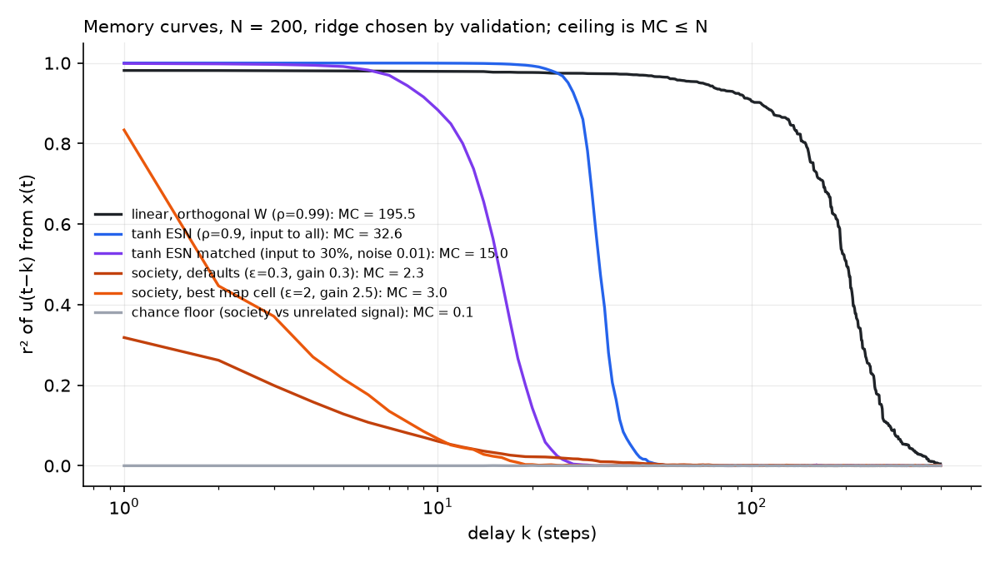
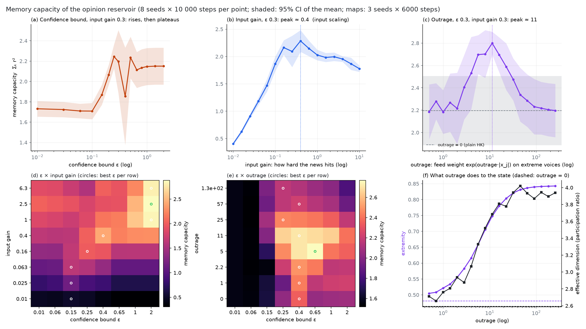
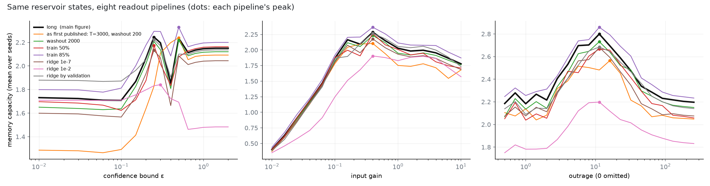

# Bound-Opinion-Reservoir

A bounded-confidence opinion model used as a reservoir computer.

A population of agents runs Hegselmann–Krause dynamics on a follow graph while a
subset of them is driven by an external signal (the news). A linear ridge readout
is trained on the agents' opinions to recover the signal's recent past. The
questions: how much can a society *remember*, as a function of how open-minded it
is, how loud the news is, and how much the feed amplifies extreme voices? And what
happens when a recommender uses that readout to decide who sees whom?

## Summary

- **The confidence bound gives no inverted U at the default settings.** Memory rises
  from closed-minded societies to a plateau and stays there. An inverted U in ε
  appears only when the news is quiet, and the best ε moves up as the news gets louder.
- **Input gain gives a clean inverted U, but it is the textbook input-scaling optimum
  of reservoir computing**, not a finding about outrage.
- **Outrage, modelled as the feed amplifying extreme voices, gives an inverted U of its
  own** at fixed input: memory capacity 2.36 → 2.81 → 2.28 (plain HK → outrage ≈ 11 →
  outrage 256) on 24 fresh seeds. This is the candidate central figure.
- **The society is a poor memory.** Through the same pipeline, an echo state network
  matched to it remembers about 15 steps of news; the society remembers 2–3.
- **Feeding the readout back into who sees whom halves memory.** A recommender that
  shows people the accounts its readout relies on turns news-exposed agents into hubs
  (largely expected, see below) and cuts memory capacity from 1.65 to 0.86 — below
  even a closed-minded society. The obvious explanation, that the state collapses into
  copies of a few hubs, was tested and is wrong: effective dimension rises as memory falls.

## The model ([bor/model.py](bor/model.py))

200 agents with opinions in [-1, 1], each following 10 random others. Per step:

1. **HK update on the graph, with outrage.** Each agent looks at the accounts it follows
   (plus itself) whose opinions lie within the confidence bound **ε**, and moves halfway
   toward their weighted mean. Account j's weight is exp(**outrage** · |x_j|). At
   outrage = 0 this is plain HK; as outrage grows, the most extreme visible voices
   dominate the feed. Extremity stands in for outrage-inducing content. The mechanism
   never touches the news input.
2. **Stubbornness.** Each agent is pulled back toward its own prior opinion at a personal
   rate in [0.02, 0.2] (Friedkin–Johnsen anchoring). Without it, informed agents
   integrate the news without leak and pin to ±1.
3. **News.** 30% of agents are informed and receive `input_gain · w_i · u(t)`, where `u` is
   i.i.d. uniform in [-1, 1] and `w_i ∈ [-1, 1]` is how each reads the news. **Input
   gain** is how hard the news hits: plain input scaling.
4. Small noise, then the opinion is clipped to [-1, 1].

## The readout ([bor/readout.py](bor/readout.py))

Closed-form ridge regression on the opinion vector plus a bias, trained on the first 70%
of the run after washout and scored on the last 30%:

- **Memory capacity** (Jaeger): Σₖ r²(u(t−k), readoutₖ(x(t))) for k = 1…30.
- **NARMA-10** one-step NRMSE, as a nonlinear check.

Main results use 10 000-step runs, washout 500 and ridge α = 1e-4 per sample. Other
pipelines are checked below.

## How much can a society remember? ([scripts/sanity_mc.py](scripts/sanity_mc.py))



Same pipeline, N = 200, delays out to 400, T = 20 000:

| reservoir | MC (validated ridge) | effective dimension |
|---|---|---|
| linear, orthogonal W, ρ = 0.99 | 195.5 | 63 |
| tanh ESN, ρ = 0.9, input to all | 32.6 | 6 |
| tanh ESN matched to the society (input to 30%, same noise) | 15.0 | 6 |
| society, defaults (ε 0.3, input gain 0.3) | 2.3 | 2.2 |
| society, best map cell (ε 2, input gain 2.5) | 3.0 | 1.1 |
| chance floor: society vs an unrelated signal | 0.06 | — |

- The pipeline reaches the theoretical ceiling MC ≤ N on a linear reservoir (195.5 of 200)
  and gives ~0 on an unrelated signal.
- The society's memory sits in the first 10–20 delays, so scoring 30 delays truncates
  nothing.
- Why so little: every informed agent stores each headline along the same direction (its
  susceptibility w_i) and forgets at nearly the same rate. The readout can tell yesterday
  from today only through the spread in stubbornness and neighbourhoods. The state is
  effectively 1–4 dimensional (participation ratio).
- The default ridge (1e-4) under-reads the tanh ESN by ~30% (23.7 vs 33). For the society
  it is within ~12% of validated ridge and doesn't change any curve's shape (below).

## Result 1: the sweeps ([scripts/sweep.py](scripts/sweep.py))



8 seeds × 10 000 steps per point; bands are 95% CIs of the mean; maps are 3 seeds × 6000
steps. Because the peaks were read off these seeds, the key contrasts were re-tested on
24 fresh seeds (100–123), paired by seed and Holm-corrected
([scripts/confirm.py](scripts/confirm.py), [results/confirm.txt](results/confirm.txt)).

**(a) Confidence bound.** MC is 1.7 for ε ≤ 0.1, where closed-minded agents never pass the
news on and the 70% who don't watch it are dead weight. It plateaus around 2.15–2.25 from
ε ≈ 0.25. On fresh seeds, ε 2 beats ε 0.01 by +0.41 [+0.30, +0.52], but ε 0.25 vs ε 2 is
+0.07 [−0.08, +0.21], p = 0.4: **no inverted U at this gain.** The wide bands near
ε ≈ 0.3–0.5 are the fragmentation–consensus transition. At ε = 0.5 half the seeds have
collapsed toward consensus and half stay split. At ε = 0.4 a few seeds' readouts fit
their training block as well as any other seed but score half as well on test; extremity
stays flat through those runs, and the cause isn't pinned down.

**(b) Input gain.** Inverted U: 0.40 → 2.28 (gain 0.4) → 1.78 (gain 10). On fresh seeds,
gain 0.4 beats 0.04 by +1.05 and 10 by +0.56 (23–24 of 24 seeds each). This is the
standard input-scaling optimum: too quiet and the news drowns in noise and stubbornness,
too loud and informed agents saturate and overshoot everyone's confidence bound.

**(c) Outrage.** Inverted U at fixed input: plain HK 2.20 → 2.80 at outrage ≈ 11 → 2.20
from outrage ≈ 100 on. On fresh seeds, outrage 11.3 beats 0 by +0.46 [+0.35, +0.56]
(21/24 seeds) and 256 by +0.53 [+0.43, +0.67] (24/24), p < 10⁻⁵ after Holm. Validated
ridge gives +0.44 and +0.59.

**(d) ε × input gain.** The best ε rises with the gain: 0.15 for quiet news, 0.25 at 0.16,
0.4 at 0.4, and 2 (full mixing) at gain ≥ 1. The bound must be wider than a news kick or
the agents who heard the news drift out of everyone else's range. An inverted U in ε only
exists for quiet news: at gain 0.063, 1.63 at ε 0.15 vs 1.08 at ε ≥ 0.65.

**(e) ε × outrage.** Outrage does nothing when ε ≤ 0.06: nobody is in reach, so there is
nothing to amplify. For every ε ≥ 0.25, memory peaks at moderate outrage (5–11) and falls
beyond it. Best cell: outrage 5, ε 0.65 (2.77).

**(f) Why.** Moderate amplification pulls opinions apart (mean |x| 0.48 → 0.75 at outrage 11)
and raises the effective dimension (2.6 → 3.7), so more distinct opinion positions carry
more independent traces of the news. Past outrage ≈ 11, extremity and dimension level off
but memory falls. A reading, not a measurement: the update approaches "copy the most
extreme account you can see", a winner-take-all rule that keeps who is loudest and
discards graded information about the news.

NARMA-10 ([figures/narma.png](figures/narma.png)) moves the same way, weakly: best NRMSE
0.65–0.66 at input gain 0.4–1 and outrage 5–11, against 0.68 at outrage 0.

### Readout robustness



The same states scored under eight readout pipelines (run length, washout, train/test
split, ridge 1e-7 / 1e-4 / 1e-2 / validated). Input gain peaks at 0.4 under all eight;
outrage peaks at 11.3 under seven (16 under the short run). The ε curve is the fragile
one. With the first draft's short runs (T = 3000) closed-minded societies scored 1.28,
with 10 000 steps 1.73, with validated ridge 1.88. Most of the first draft's "step" in ε
was the readout overfitting 140 agents that carry only noise. Strong ridge (1e-2)
instead bends the right side of the ε curve down: full-mixing states are nearly collinear,
and their signal sits in low-variance directions that heavy regularization suppresses.

## Result 2: closing the loop ([bor/recommender.py](bor/recommender.py), [scripts/feedback.py](scripts/feedback.py))

Every epoch (500 steps) the platform fits a readout for `u(t−1)` and scores each account
by its salience to that readout, `|W_j| · std(x_j)`. Then each agent, with probability
0.1, unfollows a random account and gets a recommendation drawn from
`softmax(β_s · salience_j + β_a · agreement_ij)`. Memory capacity is measured every 5
epochs on a frozen copy of the society with a fresh probe signal. Structural metrics are
averaged over each epoch. 20 seeds, each with its own news; seed s gives every policy the
same starting society, so policies are compared with the control seed by seed. 300
epochs: the salience policy's Gini plateaus around epoch 250. The summary window is the
last 50 epochs ([results/feedback_stats.txt](results/feedback_stats.txt)).


| policy (last 50 of 300 epochs) | memory capacity | Δ vs control [95% CI], d_z | active links | in-degree Gini | top-10% news-exposed | effective dimension | non-watchers' mean \|corr\| |
|---|---|---|---|---|---|---|---|
| random rewiring (control) | 1.65 | — | 0.47 | 0.17 | 0.32 | 2.2 | 0.20 |
| salience (β_s = 8) | 0.86 | −0.80 [−0.88, −0.70], −3.8 | 0.49 | 0.63 | 0.96 | 3.9 | 0.44 |
| agreement (β_a = 8) | 1.60 | −0.05 [−0.09, −0.02], −0.6 | 0.85 | 0.17 | 0.26 | 1.7 | 0.21 |
| salience + agreement | 1.45 | −0.20 [−0.31, −0.11], −0.9 | 0.71 | 0.58 | 0.99 | 2.3 | 0.66 |

Sign-flip p-values: salience 10⁻⁵, agreement 0.012, both 2·10⁻⁴.

**What is built in.** Before any rewiring, news-exposed agents are 30% of the society but
hold 60% of readout salience and 90% of the top-10% salient slots. A recommender that
promotes salient accounts makes them hubs almost by construction: the harvester elevates
whoever is closest to the signal. The dashed line in the fourth panel marks that
epoch-0 share; the salience policy overshoots it, ending with 96% of the top-10%
most-followed accounts news-exposed.

**What is not built in:**

- **The salience recommender halves the society's memory** (1.65 → 0.86, paired d_z −3.8).
  That is below a closed-minded society (1.7).
- **The memory loss is not the state collapsing.** The first draft's explanation was that
  everyone following the same hubs turns the 70% who don't watch the news into copies of
  each other. Measured on the same probes, that fails three ways:
  - Effective dimension *rises* under salience, 2.2 → 3.9 (+1.74 [+1.41, +2.06]), while
    memory falls. There are more independent directions in the state, not fewer.
  - Non-watchers do grow more alike (mean |corr| 0.20 → 0.44), but the combined policy
    goes further (0.66) and keeps most of its memory (1.45).
  - Within every policy, runs with more alike non-watchers remember *more*, not less
    (r = +0.54 to +0.81, 20 runs each). Pooled across policies the correlation is −0.17,
    so the last panel's r mostly reflects differences between policies.

  One reading of the third point is that shared movement among non-watchers is the news
  reaching them. Why memory falls remains open. The extra dimensions evidently carry
  little about past news, but what they do carry wasn't measured. These correlations are
  exploratory, read off the same runs, and none of them establishes a cause.
- **Attention inequality settles high.** In-degree Gini 0.17 → 0.63, flat over the last 50
  epochs.
- **The agreement recommender widens the effective confidence bound** without changing ε:
  85% of follow links now transmit influence, against 47% under random rewiring. Its memory
  cost is small but real (−0.05).
- **Combined**, agreement softens the salience effect (−0.20 instead of −0.80) while
  keeping most of its hub formation (Gini 0.58).

The first draft reported a sharp final-epoch drop in every line. That was a shared-input
artifact: all runs used one news sequence and active links was an end-of-epoch snapshot,
so epoch-to-epoch changes were 0.93–0.98 correlated across all four policies, control
included. Per-seed news and epoch-averaged metrics remove it.

Caveats: one network size and topology, i.i.d. input, one recommender rate and β. Memory
is probed on a frozen copy of the society, not while the platform is rewiring it.

## Reproduce

```bash
pip install -r requirements.txt
python scripts/sweep.py        # ~10 min on 12 cores; results/sweep.npz
python scripts/plot_sweep.py   # figures/sweeps.png, pipeline_robustness.png, narma.png
python scripts/confirm.py      # fresh-seed contrasts; results/confirm.txt
python scripts/sanity_mc.py    # reference reservoirs; figures/mc_sanity.png
python scripts/feedback.py     # ~20 min on 12 cores; figures/feedback.png, results/feedback_stats.txt
```

## Changes since the first write-up

1. "Outrage gain" only scaled the input, so it is now **input gain**, and outrage is a
   separate mechanism (feed amplification of extreme voices).
2. News-exposed hubs under the salience recommender are now presented as expected, with
   the epoch-0 salience share as the reference.
3. Feedback runs went from 3 to 20 paired seeds, with effect sizes, bootstrap CIs and
   permutation tests. The sweep contrasts were confirmed on fresh seeds.
4. Feedback runs went from 40 to 300 epochs. At 40 the Gini was still climbing, and the
   memory effect was a third of its final size.
5. The final-epoch drop was a shared-input artifact, now fixed (see above).
6. Memory capacity was checked against a linear reservoir (reaches the N ceiling), tanh
   ESNs, a chance floor, and eight readout pipelines. The ε curve's low end turned out to
   be pipeline-sensitive.
7. The feedback loop now tracks effective dimension and how alike non-watchers are. That
   refuted the earlier "non-watchers become copies" explanation of the memory loss.
