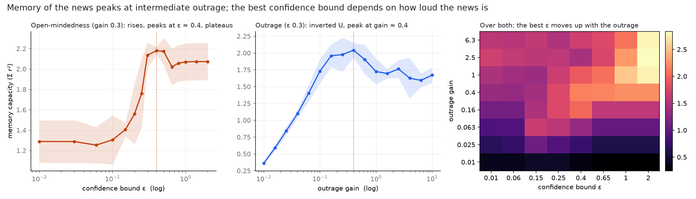
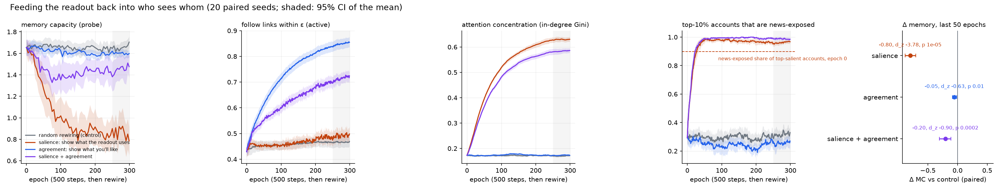

# Bound-Opinion-Reservoir

A bounded-confidence opinion model used as a reservoir computer.

A population of agents runs Hegselmann–Krause dynamics on a follow graph while a
subset of them is driven by an external signal (the news). A linear ridge readout
is trained on the agents' opinions to recover the signal's recent past. The
question: how much can a society *remember*, as a function of how open-minded it
is and how hard the news hits? And what happens when a recommender uses that
readout to decide who sees whom?

## The model ([bor/model.py](bor/model.py))

200 agents with opinions in [-1, 1], each following 10 random others. Per step:

1. **HK update on the graph.** Each agent averages over the accounts it follows (plus
   itself) whose opinions lie within the confidence bound **ε**, and moves halfway there.
2. **Stubbornness.** Each agent is pulled back toward its own prior opinion at a personal
   rate in [0.02, 0.2] (Friedkin–Johnsen anchoring). Without this, informed agents
   integrate the news with no leak and pin to ±1, so the reservoir has no fading memory.
3. **News.** 30% of agents are informed. They receive `gain · w_i · u(t)`, where `u` is
   i.i.d. uniform in [-1, 1] and `w_i ∈ [-1, 1]` is how they read the news (sign) and how
   hard (magnitude). **gain** is the outrage gain.
4. Small noise, then the opinion is clipped to [-1, 1].

## The readout ([bor/readout.py](bor/readout.py))

Closed-form ridge regression on the opinion vector (plus bias), scored on held-out data:

- **Memory capacity** (Jaeger): Σₖ r²(u(t−k), readoutₖ(x(t))) for k = 1…30.
- **NARMA-10** one-step NRMSE, as a nonlinear check.

## Result 1: the sweep ([scripts/sweep.py](scripts/sweep.py))



5 seeds per point, 3000 steps each.

- **Outrage gain gives a clean inverted U.** Memory capacity rises from 0.36 at gain 0.01
  to 2.04 at gain ≈ 0.4, then falls to ~1.6 by gain 10. Too quiet and the news drowns in
  noise and stubbornness. Too loud and informed agents slam into ±1, where clipping
  discards the signal and the kicks overshoot the confidence bound, so they stop hearing
  their neighbours.
- **The confidence bound at the default gain (0.3) is a step, not a U.** Memory capacity
  is ~1.3 for ε < 0.1 (closed-minded agents never pass the news on, so uninformed agents
  are dead weight). It jumps to 2.18 at ε ≈ 0.4, then settles at ~2.07. The dip after
  the peak is within seed noise.
- **The ε × gain map is the real figure.** At low gain (0.06–0.16) there *is* an
  inverted U in ε, peaking at ε ≈ 0.15–0.4 and dropping by a third under full-mixing
  consensus. As the gain rises, the best ε moves right: the confidence bound has to be
  wider than the size of a news kick, or the people who heard the news are pushed out of
  everyone else's range. The best cell overall is high gain *and* wide ε (MC ≈ 2.8).

So the essay-ready version is not "intermediate open-mindedness is best". It is:
**the useful amount of open-mindedness scales with how loud the news is.** The clean
inverted U is in outrage.

NARMA-10 ([figures/narma.png](figures/narma.png)) shows the same shape more weakly: the
best error is 0.665 at gain ≈ 0.4, against 0.86 at the quietest setting.

## Result 2: closing the loop ([bor/recommender.py](bor/recommender.py), [scripts/feedback.py](scripts/feedback.py))

Every epoch (500 steps) the platform fits a readout for `u(t−1)` and scores each account
by its *salience* to that readout, `|W_j| · std(x_j)`. Then each agent, with probability
0.1, unfollows a random account and gets a recommendation drawn from
`softmax(β_s · salience_j + β_a · agreement_ij)`. Memory capacity is measured on a
frozen copy of the society with a fresh probe signal. Four policies, 3 seeds, 40 epochs:



| policy | memory capacity | active links (within ε) | in-degree Gini | top-10% that are news-exposed |
|---|---|---|---|---|
| random rewiring (control) | 1.67 → 1.69 | 0.48 → 0.48 | 0.18 → 0.17 | 0.28 → 0.38 |
| salience (β_s = 8) | 1.66 → 1.56 | 0.48 → 0.46 | 0.18 → **0.34** | 0.32 → **0.99** |
| agreement (β_a = 8) | 1.68 → 1.72 | 0.48 → **0.62** | 0.18 → 0.18 | 0.28 → 0.27 |
| both | 1.68 → 1.67 | 0.48 → 0.56 | 0.18 → 0.31 | 0.30 → 0.97 |

(first 3 epochs → last 5, mean over seeds)

Where it pushes the system:

- **A salience recommender builds a broadcast hierarchy.** Showing people the accounts the
  platform's model relies on makes the news-exposed accounts into hubs. By epoch 40
  every top-10% account is directly exposed to the news, and attention inequality has
  doubled and is still climbing. Memory capacity drifts down slightly (1.66 → 1.56).
  That is within the seed spread, but it is the only policy whose MC is consistently
  below the control by the end. Funnelling everyone through the same few relays
  replaces many independent, differently delayed paths with one short one.
- **An agreement recommender widens the effective confidence bound.** It never changes ε,
  but by wiring people to those already within reach it raises the share of follow links
  that actually transmit influence from 48% to 62%. That moves the society rightward
  along the ε axis of Result 1. At gain 0.3 that axis is flat, so memory doesn't move.
- **Combined**, the salience effect dominates the network shape (hubs) and agreement
  offsets the memory loss.

Caveats: one network size, i.i.d. input, 3 seeds for the loop. The memory effect of the
recommender is small next to its structural effect. The structural results (hub
formation, active-link growth) are large and consistent across seeds.

## Reproduce

```bash
pip install -r requirements.txt
python scripts/sweep.py       # ~10 min; writes results/sweep.npz
python scripts/plot_sweep.py  # figures/inverted_u.png, figures/narma.png
python scripts/feedback.py    # ~5 min, parallel; figures/feedback.png
```
