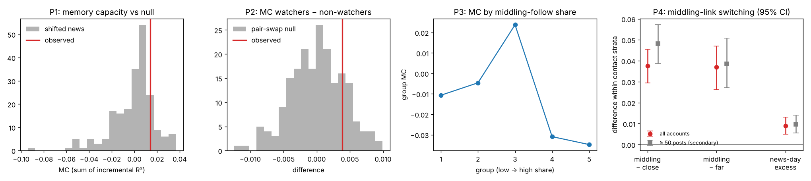

# Real-data test, round 2: results (topic-attention states)

Round 2 of the Bluesky / GDELT test planned in [REAL_DATA.md](REAL_DATA.md). The rules were
frozen in [REAL_PREREG2.md](REAL_PREREG2.md) and pushed (commit `16898c9`) before any
round-2 statistic was computed on the confirmation half. Round 1 (sentiment states) is in
[REAL_RESULTS.md](REAL_RESULTS.md).

Data:
- Failla, A. & Rossetti, G. (2024). *Bluesky social dataset*, Zenodo,
  doi:10.5281/zenodo.14669616.
- GDELT 1.0 daily event files, 17 Feb 2023 – 18 Mar 2024.

Only aggregates appear here. Full output: [results/real_confirm_r2.txt](results/real_confirm_r2.txt)
and [figures/real_confirm_r2.png](figures/real_confirm_r2.png); discovery:
[results/real_discovery_r2.txt](results/real_discovery_r2.txt); positive control:
[results/real_posctrl_r2.txt](results/real_posctrl_r2.txt).

## Short answer



**The link-switching signature of the simulation shows up, and replicates.** When accounts
are placed by *what* they post about rather than by how positive they sound, follow links at
middling distance open and close more often than close or far links, holding the amount of
contact fixed. The excess grows on high-news days. All three P4 tests pass on the
confirmation half (Holm p = 0.006), with almost the same effect sizes as on discovery. They
also survive the pre-registered guard against noisy profiles of quiet accounts.

**The memory part is still not detected.** Users' attention states hold a little news beyond
what the news itself predicts (MC 0.014). That is inside the shifted-news null (p = 0.16),
so P2 and P3 are not interpretable. The positive control shows why this is weak evidence
either way: the pipeline only sees planted memory that makes up about a fifth of a user's
day-to-day variation.

Round 1 sorted links by sentiment and found close > middling > far switching. That pattern
does not survive a better opinion axis.

## Confirmation half (pre-registered)

| prediction | statistic | null / interval | one-sided p | Holm | verdict |
|---|---|---|---|---|---|
| 1 there is memory | MC = 0.014 (39,233 users, 231 days) | shifted news: mean −0.001, 95th pct 0.026 (207 shifts) | 0.16 | 0.48 | not supported |
| 2 second-hand users hold less | MC watchers − non-watchers = +0.004 (6,050 matched pairs) | pair-swap 95th pct +0.006 | 0.17 | 0.48 | not interpretable |
| 3 middling follows cost memory | slope −0.008 per group (37,490 non-watchers) | random-group 5th pct −0.013 | 0.19 | 0.48 | not interpretable |
| 4a middling − close switching | +0.038 [+0.029, +0.046] | cluster bootstrap | 0.001 | 0.006 | passes |
| 4a middling − far switching | +0.037 [+0.026, +0.047] | cluster bootstrap | 0.001 | 0.006 | passes → **4a supported** |
| 4b middling news-day excess | +0.009 [+0.005, +0.013] | cluster bootstrap | 0.001 | 0.006 | **supported** |

0.001 is the smallest p that 1000 bootstrap draws can give.

Secondary check, outside the Holm family: positions only for accounts with at least 50
late-window posts (2.23 M edges). Middling − close +0.048 [+0.039, +0.057], middling − far
+0.039 [+0.027, +0.051], news-day excess +0.010 [+0.006, +0.014]. No sign flips and no
interval covers 0, so under the pre-registered reading the P4 result is not driven by profile
noise.

| | discovery | confirmation |
|---|---|---|
| P1 MC (null 95th pct), p | 0.012 (0.025), 0.25 | 0.014 (0.026), 0.16 |
| P2 difference, p | −0.003, 0.82 | +0.004, 0.17 |
| P3 slope, p | −0.022, 0.025 | −0.008, 0.19 |
| P4a middling − close / − far | +0.031 / +0.034 | +0.038 / +0.037 |
| P4b news-day excess | +0.012 | +0.009 |
| secondary P4 (≥ 50 posts) | +0.042 / +0.036 / +0.012 | +0.048 / +0.039 / +0.010 |

The discovery P3 slope (raw p 0.025, driven by negative MC in the top two groups) did not
replicate. P4 replicated on every line.

## What the numbers say

**Middling links switch most, once contact is held fixed.**
- Raw switches per interaction day: close 0.96, middling 1.16, far 1.19. Far links are mostly
  one-off contacts, and a single interaction already counts as an opening and a closing.
- Within interaction-day strata, the pre-registered comparison, middling links switch about
  0.04 more per edge than both close and far links.
- In round 1, sentiment distance gave the opposite order (close > middling > far). So the
  pattern depends on the opinion axis, and topical attention is the axis on which it matches
  the model.

**"More on high-news days" is relative.**
- All three classes switch slightly *less* on high-news days: log high/low ratios −0.019
  (close), −0.014 (middling) and −0.027 (far).
- Middling links fall the least, and far links the most.
- So the news-day excess is a smaller drop, not an absolute rise. It matches the
  pre-registered statistic but is weaker than "the news switches edge links on and off".

**The memory measure is too insensitive to settle P1–P3.**
- Positive control on discovery:
  - It plants an exponential trace of the news (λ = 0.8, each user reading it along their
    own random direction) in 30% of users.
  - The traces alone, used as the state, would give MC 0.31.
  - Planted into the real states, the MC rises above the null's 95th percentile only at
    amplitude 0.5. There the trace's standard deviation is half that of each user's own
    day-to-day variation, and MC reaches 0.040.
  - At amplitude 0.3 and below, MC stays at the unplanted 0.012.
- The observed 0.012–0.014 is consistent with no memory. It is equally consistent with real
  memory that is smaller than what the pipeline can resolve.
- A first version of the control used one news direction for everyone. Even its oracle
  scored −0.004: one direction carries almost nothing once the 5-component news baseline is
  removed.

## Caveats

- **Observational.** P4 is a correlation between attention distance and contact switching.
  It does not show that the switching *causes* any loss of memory: that link is the part the
  simulation adds and this test cannot see.
- **Attention is not stance.** Two accounts at middling attention distance post about partly
  different things. That can make contact patchy for reasons unrelated to tolerance.
- **The holdout was reused.** The confirmation half had been scored in round 1 with sentiment.
  The populations, windows and news rules were therefore already seen on it; only the
  attention measure is new to it.
- **The follow graph is a single snapshot**, taken at the end of the window.
- **The lexicon leave-out was dropped** for the attention states (see REAL_PREREG2.md), so
  repeated headlines can count as memory. That would bias P1 upward, and P1 still fails.

## Reproduce

Extraction as in REAL_RESULTS.md. Then:

```
export OMP_NUM_THREADS=1 OPENBLAS_NUM_THREADS=1
python scripts/real_analysis.py run --half discovery --round 2 --only 12 --tag _p12 --nproc 4
python scripts/real_analysis.py run --half discovery --round 2 --only 34 --tag _p34 --nproc 4   # fits results/real_cuts_r2.json
python scripts/real_analysis.py run --half discovery --round 2 --only 5  --tag _p5
python scripts/real_posctrl.py --nproc 4
python scripts/real_analysis.py run --half confirm --round 2 --only 12 --tag _p12 --nproc 4
python scripts/real_analysis.py run --half confirm --round 2 --only 34 --tag _p34 --nproc 4
python scripts/real_analysis.py run --half confirm --round 2 --only 5  --tag _p5
python scripts/real_report.py discovery 2
python scripts/real_report.py confirm 2
```

Timing on 4 cores with single-threaded BLAS:
- extraction: about 40 minutes;
- each half's round-2 analysis: about 35 minutes (excluding loading);
- positive control: 3 minutes.
